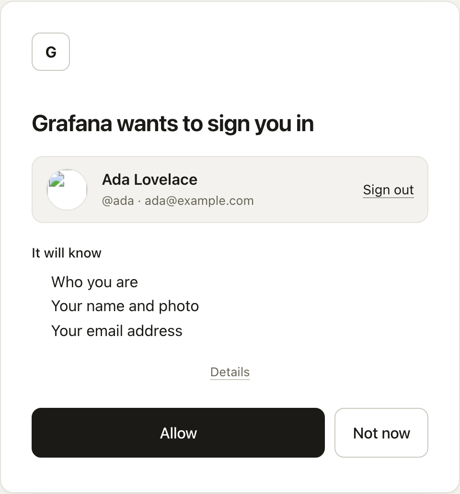

masks knows how to set up many apps. You pick the app, enter its address, and masks shows you
what to paste into the app's own settings.

## Add the app

1. Open **Manage this server**, then **Clients**, and choose **Add client**.
2. Under **What kind of client**, choose **A known product**.
3. Pick the app under **Product**.
4. Enter **Its address**, the address people open the app at, such as
   `https://grafana.example.com`.
5. Some apps also ask for **Name it uses for masks**. Keep `masks` unless the app's settings
   already use another name.
6. Choose **Add the client**.

masks shows a page headed with the app's name and **is ready**. It lists every value to enter in
the app, under the app's own name for each one. The secret is among them, and it is not shown
again, so copy the values now.

- **Its guide** opens the app's own instructions for this kind of sign-in.
- **Open it** opens the app.

Paste the values into the app's settings and save them. From then on, the app appears under
**Your apps** on everyone's account page.

The first time a person opens the app, masks shows what the app will know about them and asks
them to **Allow** it.

## What each app needs

| App                                                                                                                                                                                              | Needs beyond its address                                                                    |
| ------------------------------------------------------------------------------------------------------------------------------------------------------------------------------------------------ | ------------------------------------------------------------------------------------------- |
| Grafana, Nextcloud, Immich, Outline, Audiobookshelf, Portainer, Vaultwarden, Mealie, Open WebUI, Headscale, Home Assistant (OIDC integration), BookStack, MinIO, Argo CD, Synology DSM            | Nothing.                                                                                    |
| Gitea, Forgejo, Paperless-ngx, Proxmox VE, Jellyfin (SSO plugin), Matrix (Synapse)                                                                                                                | **Name it uses for masks**.                                                                 |
| Wiki.js                                                                                                                                                                                          | **Name it uses for masks**. Wiki.js shows it in the strategy's callback URL. Copy it from there. |
| Tailscale                                                                                                                                                                                        | Nothing. Its address is `https://login.tailscale.com`. See [Tailscale](#tailscale).          |
| Any app behind Caddy, Traefik, or nginx                                                                                                                                                          | Nothing. This one is for operators. See [forward authentication](/build/forward-auth/).      |

## Who gets to be an administrator

Many of these apps read the groups a person is in. In Grafana, Gitea, Jellyfin, Mealie, Open WebUI,
Headscale, Home Assistant, and Argo CD, the settings masks shows make the members of a group called
`admins` the app's administrators. In MinIO, name each group after the MinIO policy it should
hold. In every other app, choose the administrators in the app.

To put people in a group:

1. Open **Settings**, then **General**, then **Groups**, and add a group called `admins`.
2. Open each person under **Actors**, open their **Access** tab, and tick the group.

## Who may sign in

By default, everyone with an account can sign in to the app. To limit it:

1. Open the app under **Clients** and open its **Access** tab.
2. Under **Who may sign in**, tick the groups that may.

Anyone else who tries lands on a page that says the sign-in was refused, with **Ask for access**.
Each request waits under **Access requests** on the same tab, where a manager chooses **Approve**
or **Decline**. The person gets an email either way.

## Tailscale

Tailscale finds a sign-in server through the domain of a person's email address. So your masks
server has to answer at that domain. A person whose address is `ada@id.example.com` needs masks at
`https://id.example.com`.

1. In masks, add Tailscale as a known product with `https://login.tailscale.com` as its address.
   Keep the values masks shows.
2. In Tailscale, start a new tailnet with a custom OpenID Connect provider. Enter an email
   address at your masks domain, and paste the values.
3. Sign in. Each person on your server joins the tailnet with their own account.

Headscale, the self-hosted control server, does not need this. Add it as a known product with its
own address.

## Apps that are not on the list

An app that is not on the list can still use masks, as long as it supports the same open standard.
Setting one up by hand is for developers and operators. See
[connecting via SDK](/build/connecting-via-sdk/).
