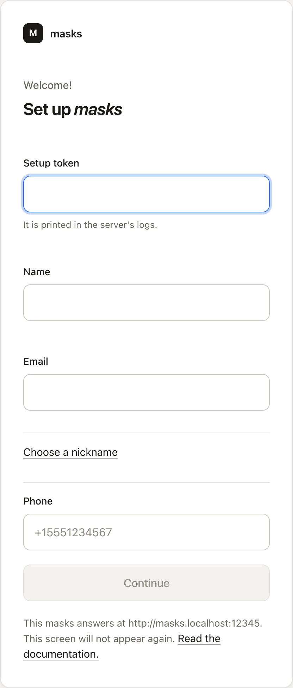
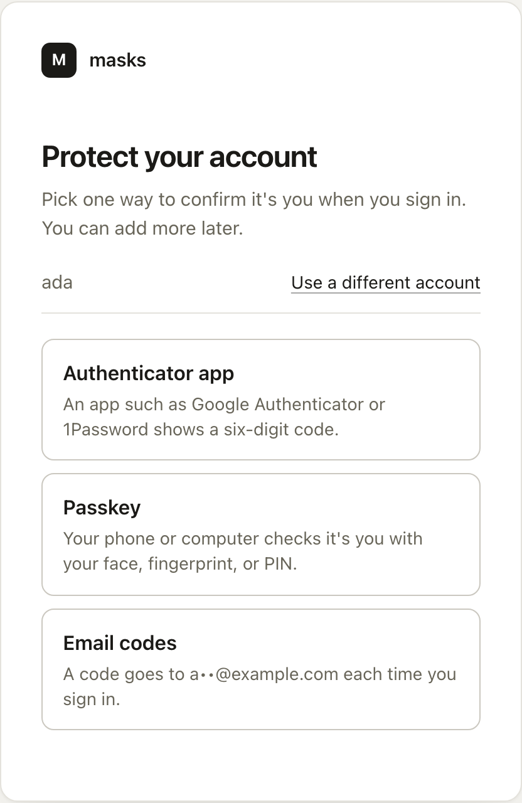

The first time anyone opens your masks server, it shows the **Set up** screen. The screen has
three parts: **Identification**, **Credentials**, and **Configuration**. Only someone who has the
setup token from the server's output can get past it.

## Identification

1. Enter the **Setup token**. It is printed in the server's output. See
   [run masks in one container](/use/run-masks/).
2. Enter your **Name** and your **Email**. Invitations and password resets for managers go to
   the address.
3. masks makes a nickname from your email address. Other people see it. To pick your own, choose
   **Choose a nickname** and enter it.
4. Choose **Continue**.

## Credentials

Under **Sign in with**, choose **A passkey** or **A password**.

- **A passkey**: choose **Create a passkey**. Your phone or computer checks it is you with your
  face, fingerprint, or PIN. There is no password to remember, and you can add one later from
  your account page.
- **A password**: enter it twice, under **Password** and **Confirm password**. It needs at least 8
  characters. masks refuses the most common passwords.

Choose **Create the manager**. masks makes your account.

## Protect your account

A manager always has a second way to prove it is them at sign-in. A passkey counts as both steps
at once, so if you made one, masks skips this part.

If you chose a password, the **Protect your account** screen asks you to pick one way to confirm
it is you when you sign in:

- **Authenticator app**. An app such as Google Authenticator or 1Password shows a six-digit code.
  Scan the code on the screen with the app, enter the six-digit code the app shows, and choose
  **Turn it on**.
- **Passkey**. Your phone or computer checks it is you with your face, fingerprint, or PIN.
  Choose **Add a passkey**.

Once one is on, masks shows your **Backup codes**. Each code signs you in once if you lose your
other way in. Choose **Copy them** or **Download them**, keep them somewhere safe, and tick
**I saved my backup codes**. They are not shown again.

Choose **Continue**.

## Configuration

1. Under **This server is called**, enter a name, such as your family's or company's name. It
   heads every screen and every email masks sends.
2. Choose **Finish setting up**.

The screen does not appear again. You land on your [account page](/use/your-account/). At the
top, **Manage this server** opens the pages where managers work.

## Next steps

- [Invite and approve people](/use/invite-people/).
- [Connect an app from the known list](/use/connect-an-app/).
