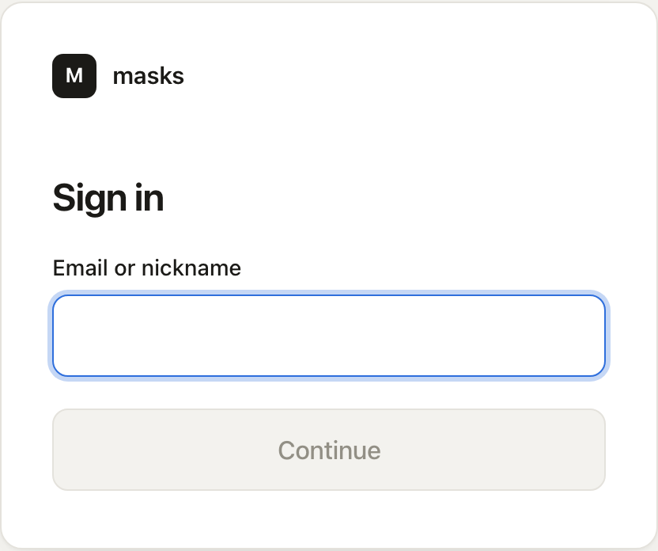
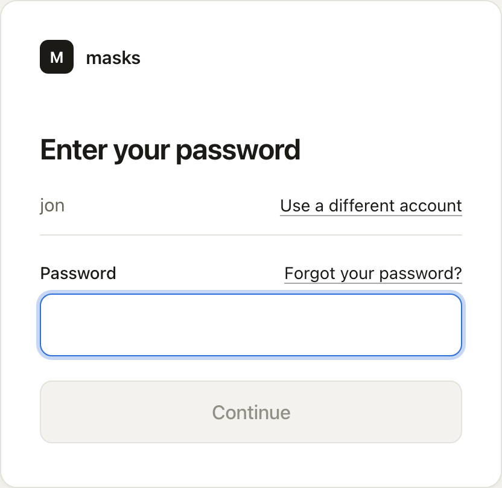
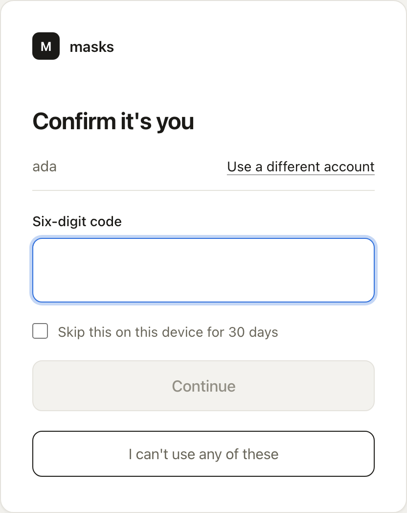

People sign in to masks, and masks signs them in to your apps. A sign-in has a first step that
proves who you are, and often a second step that confirms it.

## How a sign-in goes

1. Enter your **Email or nickname**.
2. Enter your password, or use your passkey.
3. If your account has a second step, masks asks **Confirm it's you**. Enter the code from your
   authenticator app, or confirm with your passkey.

An app that uses masks sends you to these screens the first time, and to **Allow** what the app
may know about you. After that, masks remembers you for 14 days on that browser, and most apps
sign you in without a question.

## Passkeys

A passkey lives on your phone or computer. Your device checks it is you the way it already
unlocks, with your face, fingerprint, or PIN. There is no password to type, and a passkey counts
as both steps at once.

- To add one, open **Passkeys** on your [account page](/use/your-account/) and choose
  **Set this up**. Give it a name, such as **My laptop**.
- To sign in with one, choose **Use a passkey** on the sign-in page. In many browsers your
  passkey also appears as a suggestion in the **Email or nickname** field.
- A passkey works only on the address it was made on.

## Codes by email

Some servers let you sign in with a code instead of a password. On the password step, choose
**Email me a code instead**. masks emails a six-digit code to your address. It works for ten
minutes, and you can ask for another after 30 seconds with **Send another code**.

A code sent by email never counts as the second step of that sign-in.

## Authenticator apps

An authenticator app, such as Google Authenticator or 1Password, shows a six-digit code that
changes every 30 seconds. It works without a signal.

1. Open **Authenticator app** on your account page.
2. Scan the code on the screen with the app, or type the key into it.
3. Enter **The code the app shows** and choose **Turn on**.

Every manager has an authenticator app or a passkey. Other people have one when the server's
rules ask for it, or when they turn it on themselves.

## Backup codes

Backup codes are for the day your phone or passkey is not to hand. Each code signs you in once.

- masks makes them when you turn on your first authenticator app, and shows them once. Write them
  down and keep them away from your phone.
- On the second step, choose **Use a backup code** and enter one.
- To make a new set, open **Backup codes** on your account page and choose **Make new codes**. The
  old codes stop working.

## Skip the second step on your own device

After a second step, masks offers **Skip this on this device for 30 days**. Tick it on a device
that is yours, and masks does not ask again there for 30 days, or until that device is signed
out. Your account page lists each device under **Devices**, with **Sign this device out**.

## A lost phone

When you cannot do the second step, choose **I can't use any of these** on the
**Confirm it's you** screen. masks offers what you can still do:

- **Use a backup code**, if you kept them.
- **Approve from a device you trust**. masks shows a code. On a phone or computer where you ticked
  **Skip this on this device**, open your account page, find **Approve a sign-in**, enter the
  code under **Code on the other screen**, and choose **Approve**.
- **Ask a manager for help**. masks tells every manager, and emails you too, so you notice if
  someone else asked. Asking again within a day does nothing.

When someone asks for help, a manager:

1. Opens **Manage this server**, then **Actors**, and chooses the **Asking for help** filter.
2. Opens the person. The top of their page says **Asking for help**.
3. Makes sure it is really them, by a call or in person.
4. Chooses **Reset second factors**, or **Dismiss** to drop the request.

A reset removes their authenticator app, backup codes, passkeys, and sign-in codes, and signs them
out everywhere. Their next sign-in asks them to set up a new second step.

## A forgotten password

On the password step, choose **Forgot your password?**. If the address has an account, masks
emails a link headed **Reset your password**. The link works once and lasts 30 minutes. Setting a
new password signs you out everywhere else.

A manager can also start a reset from the person's page, with **Reset password**.
